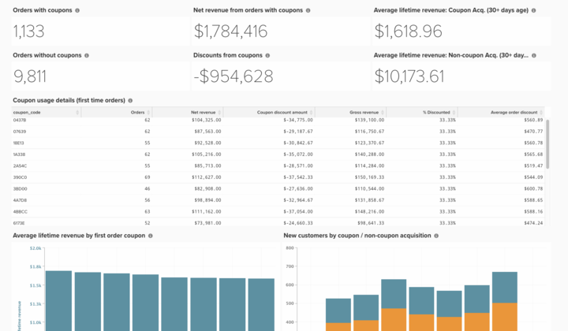
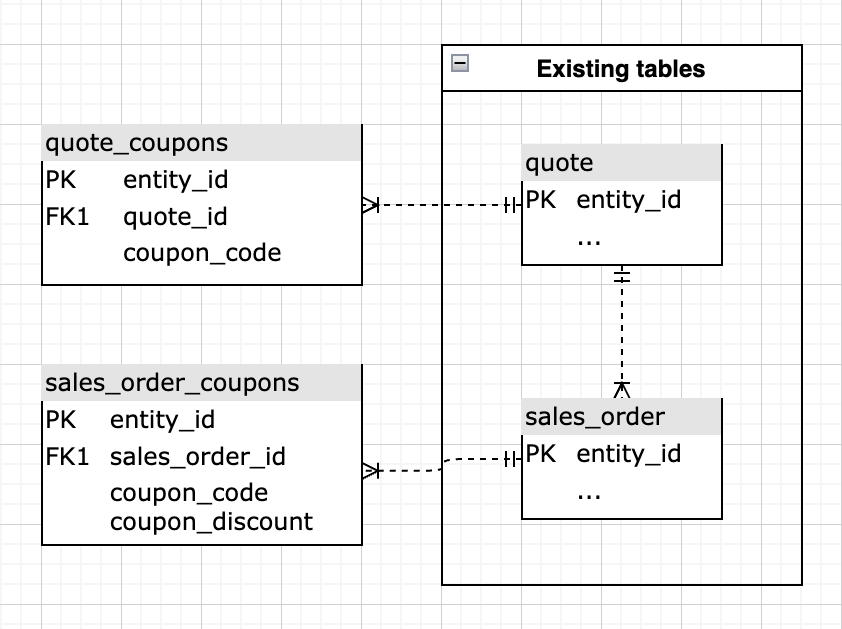

# 基本的なクーポンコード分析

ビジネスのクーポンパフォーマンスを把握することは、注文をセグメンテーションし、顧客習慣をより深く理解するための興味深い方法です。

このトピックでは、この分析を作成するために必要な手順を文書化し、クーポン取得済みの顧客のパフォーマンスを理解し、トレンドを参照し、個々のクーポンコードの使用状況を追跡します。

使用状況とパフォーマンス指標を表示する<!--{: width="807" height="471"}-->

## はじめに

まず、クーポンコードの追跡方法に関するメモ。 顧客が注文にクーポンを適用すると、次の3つが発生します。

* 割引は`base_grand_total`額（Commerce Intelligenceの`Revenue`指標）に反映されます
* クーポンコードは`coupon_code` フィールドに保存されます。 このフィールドがNULL （空）の場合、注文にはクーポンが関連付けられていません。
* 割引金額は`base_discount_amount`に格納されています。 設定に応じて、この値は負または正のように表示される場合があります。

Commerce 2.4.7以降、お客様は複数のクーポンコードを注文に適用できます。 この場合：

* 適用されたすべてのクーポンコードは、`sales_order_coupons`の`coupon_code` フィールドに格納されます。 適用された最初のクーポンコードは、`sales_order`の`coupon_code` フィールドにも保存されます。 このフィールドがNULL （空）の場合、注文にはクーポンが関連付けられていません。

## 指標の構築

最初の手順は、次の手順で新しい指標を作成することです。

* **[!UICONTROL Manage Data > Metrics > Create New Metric]**&#x200B;に移動します。

* `sales_order`を選択します。
* この指標は、**created_at**&#x200B;によって注文された&#x200B;**base_discount_amount**&#x200B;列に&#x200B;**Sum**&#x200B;を実行します。
  * [!UICONTROL Filters]:
    * `Orders we count` （保存されたフィルターセット）を追加
    * 以下を追加します。
      * `coupon_code`**は**`[NULL]`&#x200B;ではありません
    * 指標に`Coupon discount amount`などの名前を付けます。

## ダッシュボードの作成

* 指標を作成したら、次の操作を行います。
  * [!UICONTROL Dashboards > Dashboard Options > Create New Dashboard]**に移動します。
  * ダッシュボードに`_Coupon Analysis_`などの名前を付けます。

* ビューでは、すべてのレポートを作成および追加できます。

## レポートの作成

* **新しいレポート：**

>[!NOTE]
>
>各レポートの[!UICONTROL Time Period]**は`All-time`として表示されます。 分析ニーズに合わせて変更してください。 Adobeでは、`All time`、`Year-to-date`、`Last 365 days`など、このダッシュボードのすべてのレポートが同じ期間をカバーすることをお勧めします。

* **クーポン付きの注文**
  * &#x200B;
    [!UICONTROL 指標]&#x200B;: `Orders`
    * フィルターを追加：
      * [`A`] `coupon_code` **は** `[NULL]`ではありません

  * [!UICONTROL Time period]&#x200B;: `All time`
  * &#x200B;
    [!UICONTROL 間隔]&#x200B;: `None`
  * [!UICONTROL Chart type]&#x200B;:`Number (scalar)`

* **クーポンなしの注文**
  * &#x200B;
    [!UICONTROL 指標]&#x200B;: `Orders`
    * フィルターを追加：
      * [`A`] `coupon_code` **は** `[NULL]`

  * [!UICONTROL Time period]&#x200B;: `All time`
  * &#x200B;
    [!UICONTROL 間隔]&#x200B;: `None`
  * [!UICONTROL Chart type]&#x200B;:`Number (scalar)`

* **クーポンを使用した注文の純収益**
  * &#x200B;
    [!UICONTROL 指標]&#x200B;: `Revenue`
    * フィルターを追加：
      * [`A`] `coupon_code` **は** `[NULL]`ではありません

  * [!UICONTROL Time period]&#x200B;: `All time`
  * &#x200B;
    [!UICONTROL 間隔]&#x200B;: `None`
  * [!UICONTROL Chart type]&#x200B;: `Number (scalar)`

* **クーポンの割引**
  * [!UICONTROL Metric]&#x200B;: `Coupon discount amount`
  * [!UICONTROL Time period]&#x200B;: `All time`
  * &#x200B;
    [!UICONTROL 間隔]&#x200B;: `None`
  * [!UICONTROL Chart type]&#x200B;: `Number (scalar)`

* **平均生涯売上：獲得したクーポン顧客**
  * [!UICONTROL Metric]&#x200B;: `Avg lifetime revenue`
    * フィルターを追加：
      * [`A`] `Customer's first order's coupon_code` **は** `[NULL]`ではありません

  * [!UICONTROL Time period]&#x200B;: `All time`
  * &#x200B;
    [!UICONTROL 間隔]&#x200B;: `None`
  * [!UICONTROL Chart type]&#x200B;: `Number (scalar)`

* **平均生涯売上：非クーポン獲得顧客**
  * [!UICONTROL Metric]&#x200B;: `Avg lifetime revenue`
    * フィルターを追加：
      * [A] `Customer's first order's coupon_code` **は**`[NULL]`

  * [!UICONTROL Time period]&#x200B;: `All time`
  * &#x200B;
    [!UICONTROL 間隔]&#x200B;: `None`
  * [!UICONTROL Chart type]&#x200B;: `Number (scalar)`

* **クーポン使用状況の詳細（初回注文）**
  * 指標`1`: `Orders`
    * フィルターを追加：
      * [`A`] `coupon_code` **は**`[NULL]`&#x200B;ではありません
      * [`B`] `Customer's order number` **次と等しい** `1`

  * 指標`2`: `Revenue`
    * フィルターを追加：
      * [`A`] `coupon_code` **は**`[NULL]`&#x200B;ではありません
      * [`B`] `Customer's order number` **次と等しい** `1`

    * 名前を変更：`Net revenue`

  * 指標`3`: `Coupon discount amount`
    * フィルターを追加：
      * [`A`] `coupon_code` **は**`[NULL]`&#x200B;ではありません
      * [`B`] `Customer's order number` **次と等しい** `1`

  * 数式の作成：`Gross revenue`
    * [!UICONTROL Formula]&#x200B;: `(B – C)`
    * &#x200B;
      [!UICONTROL Format]&#x200B;: `Currency`

  * 数式を作成：**%割引**
    * 数式：`(C / (B - C))`
    * &#x200B;
      [!UICONTROL Format]&#x200B;: `Percentage`

  * 数式の作成：`Average order discount`
    * [!UICONTROL Formula]&#x200B;: `(C / A)`
    * &#x200B;
      [!UICONTROL Format]&#x200B;: `Percentage`

  * [!UICONTROL Time period]&#x200B;: `All time`
  * &#x200B;
    [!UICONTROL 間隔]&#x200B;: `None`
  * &#x200B;
    [!UICONTROL チャートタイプ]&#x200B;: `Table`

* **初回注文クーポンによる平均生涯売上**
  * [!UICONTROL Metric]&#x200B;:**平均生涯売上**
    * フィルターを追加：
      * [`A`] `coupon_code` **は**`[NULL]`

  * [!UICONTROL Time period]&#x200B;: `All time`
  * &#x200B;
    [!UICONTROL 間隔]&#x200B;: `None`
  * [!UICONTROL Chart type]&#x200B;: `Number (scalar)`

* **クーポン使用状況の詳細（初回注文）**
  * [!UICONTROL Metric]&#x200B;: `Avg lifetime revenue`
    * フィルターを追加：
      * [`A`] `Customer's first order's coupon_code` **は** `[NULL]`ではありません

  * [!UICONTROL Time period]&#x200B;: `All time`
  * &#x200B;
    [!UICONTROL 間隔]&#x200B;: `None`
  * [!UICONTROL Group by]&#x200B;: `Customer's first order's coupon_code`
  * &#x200B;
    [!UICONTROL チャートタイプ]&#x200B;: **Column**

* **クーポンによる新規顧客/クーポン以外の獲得**
  * 指標`1`: `New customers`
    * フィルターを追加：
      * [`A`] `Customer's first order's coupon_code` **は** `[NULL]`ではありません

    * [!UICONTROL Rename]&#x200B;: `Coupon acquisition customer`

  * 指標`2`: `New customers`
    * フィルターを追加：
      * [`A`] `coupon_code` **は**`[NULL]`

    * [!UICONTROL Rename]&#x200B;: `Non-coupon acquisition customer`

  * [!UICONTROL Time period]&#x200B;: `All time`
  * [!UICONTROL Interval]&#x200B;: `By Month`
  * [!UICONTROL Chart type]&#x200B;: `Stacked Column`

レポートを作成した後、ダッシュボードでレポートを整理する方法については、このトピックの上部にある画像を参照してください。

>[!NOTE]
>
>Adobe Commerce 2.4.7以降、お客様は&#x200B;**quote_coupons**&#x200B;および&#x200B;**sales_order_coupons**&#x200B;のテーブルを使用して、お客様が複数のクーポンをどのように使用しているかについてのインサイトを取得できます。

