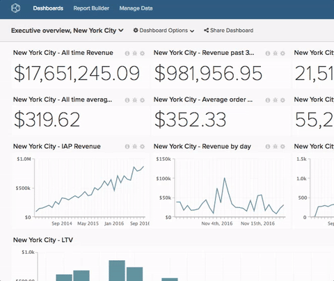

# ダッシュボード名の変更

>[!NOTE]
>
>これらの機能を実行するには、[管理者](../../administrator/user-management/user-management.md)または`Standard`の権限が必要です。 `Standard` ユーザーの場合は、ダッシュボードに対する`Edit`権限も必要です。

名前が合わないこともあります。 ダッシュボードの名前の変更はすばやく簡単です。

1. ダッシュボードで、`Global Search` メニューの横にある画面上部の&#x200B;**[!UICONTROL Dashboard Options]** メニューをクリックします。

1. ドロップダウンで「**[!UICONTROL Rename]**」をクリックします。

1. プロンプトが表示されたら、ダッシュボードの新しい名前を入力します。

1. **[!UICONTROL Save Changes]**&#x200B;をクリックします。

例：

